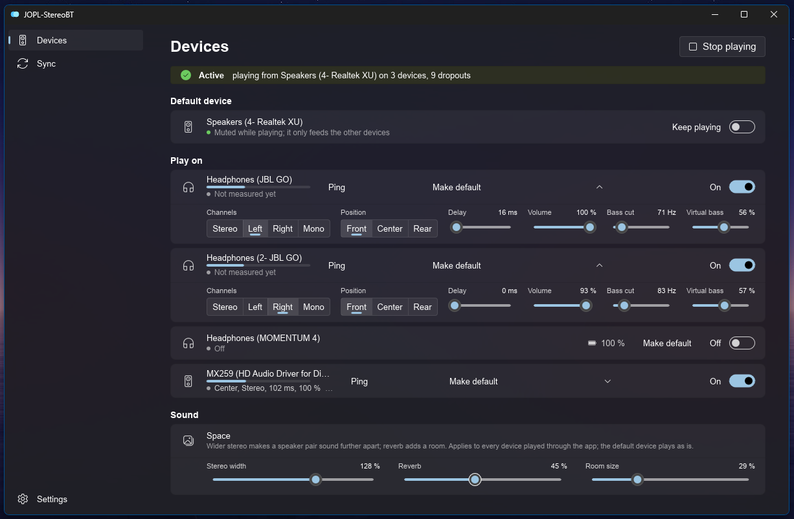

# JOPL-StereoBT

Play Windows system audio on several devices at once (Bluetooth speakers and headphones,
monitors, built-in speakers), in sync. Every device gets its own delay, channels (stereo,
left, right, mono), volume and surround position; small speakers get bass shaping, and the
whole set a wider stereo image and reverb. No virtual audio driver needed.



- **In sync**: measure every device's latency with the microphone (or sync by ear) and let
  the app set the delays; clock drift between devices is corrected continuously.
- **Stereo from two speakers**: one speaker plays left, the other right.
- **Small speakers**: bass cut, virtual bass and a limiter make e.g. a JBL Go sound fuller
  and cleaner.
- **Surround from stereo**: devices can play front, center (voices) or rear (ambience).
- **Space**: stereo width and room reverb.
- **Handy**: follows the Windows volume, battery levels, level meters, a Ping button to tell
  identical speakers apart, a tray icon, and the Windows 11 look with your accent colour.

Windows 11, portable: a single `jopl-stereo-bt.exe`, no installer. MIT licence, see
[LICENSE](LICENSE). Product description: [PRODUCT.md](PRODUCT.md).

## Build

Needs Rust 1.98 or newer.

```sh
cargo build --release
```

The exe is `target/release/jopl-stereo-bt.exe`.

## Use

1. **Devices**: switch on the devices to play on; per device pick channels, position,
   delay and volume. The ▴/▾ button collapses a card to a one-line summary.
2. Press **Play on multiple devices**.
3. **Sync**: measure with the microphone (or sync by ear) to align the devices; the page
   shows when each device plays.
4. **Small speakers** (e.g. JBL Go), per device:
   - **Bass cut**: removes bass the speaker cannot play, so it sounds louder and cleaner
     (lowest position is off).
   - **Virtual bass**: adds harmonics above the bass cut, so the cut bass is still heard
     (try 50–100 %). Set the bass cut to where the speaker stops playing bass (JBL Go:
     about 180 Hz) first: the harmonics are placed above it.
   - A limiter always prevents clipping.
5. **Surround** (Position): **Front** plays stereo as usual, **Center** plays the middle
   (voices), **Rear** plays only the ambience, slightly later, so music and films get a
   surround feel, e.g. the laptop in front and two JBLs behind you on Rear (one Left, one
   Right).
6. **Sound → Space**: **Stereo width** above 100 % makes a speaker pair (one on Left, one
   on Right) sound further apart; **Reverb** and **Room size** add a room. Applies to every
   device played through the app, not to the default device.
7. **Settings**: keep the default device playing, follow the system volume, keep playing
   when the window is closed.

Settings are saved per device in `%APPDATA%\JOPL-StereoBT\settings.toml`.

### Ping and level meters

While playing, each device card shows a level meter, and the **Ping** button (the speaker
icon next to the device name) plays a short double beep on that device only, handy to tell
two identical speakers apart.

### Battery levels

Device cards show the battery level Windows knows for a Bluetooth device (the same as in
Settings → Bluetooth & devices), refreshed every minute. Not every device reports one, and
the level arrives through the hands-free (call) profile: with **Handsfree Telephony**
disabled for a device, Windows no longer receives it.

## Troubleshooting

### `0x8889000F`: a second Bluetooth device does not play

Windows could not open the device (`AUDCLNT_E_ENDPOINT_CREATE_FAILED`). The first Bluetooth
speaker plays, the second shows this error, and it plays as soon as the first is switched
off.

**Cause on Intel laptops:** Bluetooth audio offload. Newer Intel laptops route Bluetooth audio
through the Intel Smart Sound Technology audio DSP, and that path handles only one Bluetooth
audio stream at a time.

**Fix:**

1. Open Device Manager, expand *Sound, video and game controllers*.
2. Right-click **Intel® Smart Sound Technology for Bluetooth® Audio** and choose
   **Disable device**. Disable only this entry: *Intel SST Audio Controller* and
   *Intel SST OED* run the built-in speakers and microphone.
3. Restart, then reconnect (or re-pair) the Bluetooth devices.

Windows then uses its own Bluetooth audio driver, which plays to several devices at once.
To undo, enable the same entry again and restart.

**Drawbacks** (small for classic Bluetooth speakers and headphones):

- Slightly more processor and battery use: the main processor encodes the Bluetooth audio.
- Bluetooth LE Audio (LC3, e.g. sharing audio to several LE earbuds) likely needs the
  offload path.
- Headset calls (Teams and similar) use Windows' own hands-free driver; normally fine, but
  call quality may differ slightly.
- Driver or Windows updates can enable the device again: check Device Manager when the
  error returns.
- Latency changes: measure again on the **Sync** page.

Without such an offload device, the Bluetooth chip or driver itself may be limited to one
audio device. Update the Bluetooth driver (laptop maker first, then Intel or MediaTek), or
connect the extra speaker through a USB Bluetooth audio transmitter (its own sound card) or
an AUX cable.

### `0x8889000A`: device in use

Another program holds the device in exclusive mode (`AUDCLNT_E_DEVICE_IN_USE`), which
happens for example with monitor audio over HDMI/DisplayPort. Close that program, or open
`mmsys.cpl`, then the device's **Properties → Advanced**, and untick **Allow applications
to take exclusive control of this device**.

### No sound from an app

If one app (for example a browser) is muted for the default device in the Windows volume
mixer, its audio reaches no device. The app shows a warning with an **Unmute** button.

## Licences

JOPL-StereoBT is MIT licensed. The user interface is built with [Slint](https://slint.dev)
under its Royalty-free Desktop License; the About section on the Settings page shows the
required Slint notice.
